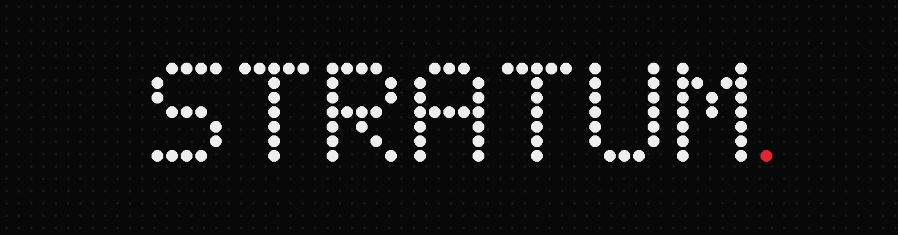
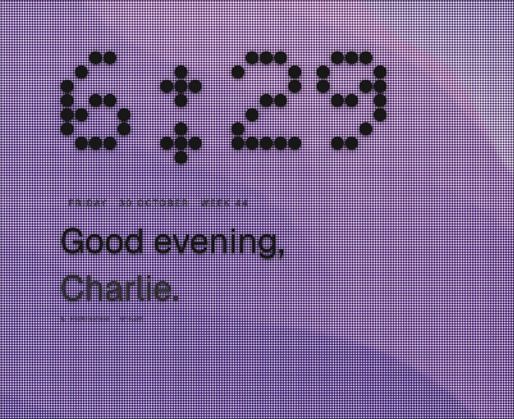
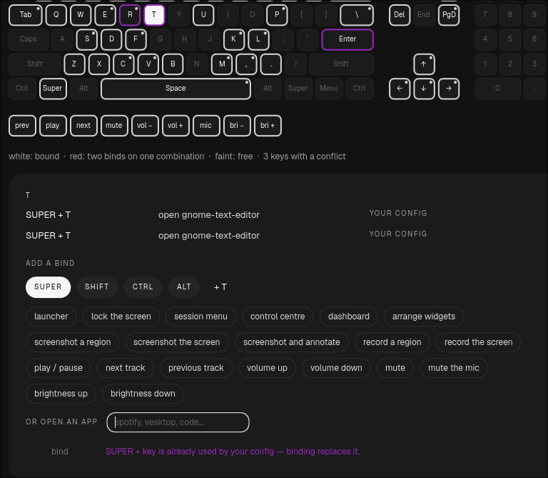
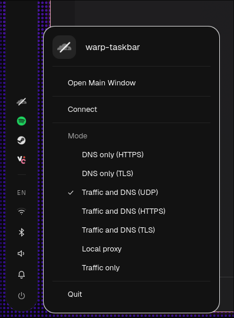
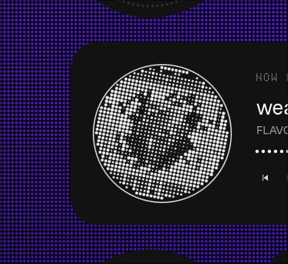
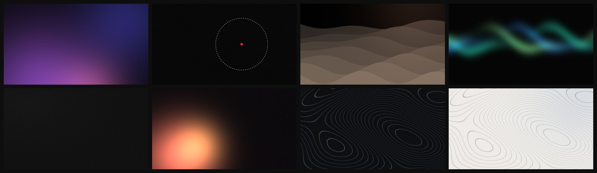

<p align="center">
  
</p>

<p align="center">
  <b>A desktop shell for Hyprland, in dots.</b><br>
  Built on <a href="https://quickshell.org">Quickshell</a> · inspired by Nothing OS · your colours, or your wallpaper's
</p>

<p align="center">
  <a href="#install">Install</a> ·
  <a href="#what-you-get">What you get</a> ·
  <a href="#keys">Keys</a> ·
  <a href="#control-it-from-anywhere">stratumctl</a> ·
  <a href="docs/TROUBLESHOOTING.md">Troubleshooting</a>
</p>

---

<p align="center">
  
</p>

Stratum draws the whole desktop as layers — wallpaper, widgets, bar and panels,
overlays, lock screen — and draws all of it in dots. Every gauge is a dotted ring,
every progress bar a row of dots, the clock a dot matrix, album art dithered into
dots. It takes its colours from you: one accent you pick, or a full matched palette
from your wallpaper, carried into your terminal, Spotify, Discord and GTK apps.

## What you get

<table>
<tr>
<td width="50%" valign="top">

**Bar** — a column down either side or a strip along the top, per monitor.
Workspaces, clock, tray (with its menus right in a popout), and hover popouts for
Wi-Fi, Bluetooth, sound and battery.

**Control centre** — Wi-Fi, Bluetooth, brightness and volume (scroll them),
toggles you arrange yourself, including **game mode** and VPN (WARP, Tailscale,
Mullvad, NetworkManager), now playing, notifications.

**Launcher** — <kbd>Super</kbd> + <kbd>Space</kbd>. Apps ranked by how often you
open them, files, open windows, single settings, actions and sums, with a preview
beside the list. Type <code>&gt;</code> to search one kind.

**Dashboard** — time, weather, processor/memory/GPU rings, per-core load, top
processes by CPU, memory or GPU, network, media.

</td>
<td width="50%" valign="top">

**Desktop widgets** — thirteen of them on a snapping grid, per monitor: clock,
greeting, weather, calendar, now playing, gauges, photo. They step aside for
windows, and pick light or dark ink from the wallpaper behind them.

**Lock screen** — a real session lock with a composed entrance, your photo, and a
password row of dots.

**Settings** — a proper window with search that forgives typos and knows other
words for things. Displays you can drag to arrange, sound, network, Bluetooth,
power profiles with energy savers, motion, weather with a map, keybinds drawn as a
keyboard, updates.

**Colours everywhere** — accent or wallpaper (matugen) colours applied to the
shell, window borders, terminal, Spotify (Spicetify), Vesktop and GTK.

</td>
</tr>
</table>

<p align="center">
  
  &nbsp;
  
  &nbsp;
  
</p>

## Install

Stratum runs on **Hyprland** (0.50 or newer; Lua and classic `.conf` configs both work)
through **Quickshell**. The installer sets up everything else.

### 1. Get it

```bash
git clone https://github.com/imnuclr/stratum.git ~/stratum
cd ~/stratum
```

Keep the folder: Quickshell runs Stratum straight from it, so updating is a `git pull`.

### 2. Run the installer

```bash
./install.sh
```

It walks through five steps, asking before anything that changes your system:

1. **Tools** — installs everything the shell uses, automatically:

   | Tool | For |
   |---|---|
   | quickshell | the shell runtime |
   | grim, slurp, satty, wl-clipboard | screenshots, region select, annotation, copying |
   | wireplumber (`wpctl`) | volume |
   | brightnessctl, ddcutil | laptop and external-monitor brightness |
   | power-profiles-daemon, upower | power profiles, battery |
   | hyprsunset | night light |
   | networkmanager, bluez | Wi-Fi, Bluetooth |
   | gpu-screen-recorder | screen recording |
   | matugen | colours from the wallpaper |
   | plocate, zenity, libnotify | launcher file search, file chooser, notifications |
   | nvidia-utils | GPU readings — only on machines with an NVIDIA card |

   On **Arch** it uses pacman, and an AUR helper (paru or yay; it offers to install paru
   if you have neither) for quickshell, matugen and gpu-screen-recorder. On **Fedora**
   it uses dnf and the `errornous/quickshell` COPR. On anything else it prints the list
   to install yourself — then run `./install.sh --no-deps`.

2. **Setup** — turns on the power-profiles, Bluetooth and file-index services, and sets
   up I2C so external monitors' brightness can be changed (you are added to the `i2c`
   group; log out and back in once for that). Offers **rembg** (optional, ~400 MB) for
   the wallpaper depth effect.
3. **Linking** — links the folder into `~/.config/quickshell/stratum`, puts the
   `stratum`, `stratumctl` and `shellctl` commands in `~/.local/bin`, and fetches the
   fonts.
4. **Hyprland** — writes `~/.config/hypr/stratum-binds.lua` (or `.conf`) and, if you
   say yes, adds the one line that loads it to the end of your config, plus a line
   that starts Stratum with Hyprland. Nothing else in your config is touched.
5. **Apps (optional)** — pick any of: VS Code, Spotify (with Spicetify set up),
   Vesktop, Discord, Firefox, Steam, OBS, Obsidian, Kitty, btop.

Non-interactive: `./install.sh --yes`. Apps without asking:
`./install.sh --apps vscode,spotify,vesktop` (`--list-apps` shows them all).

### 3. Start it

```bash
stratum start
```

Or log out and back in if you let the installer add it to Hyprland. Then check
everything is in order:

```bash
stratum doctor
```

### Updating

```bash
stratum update
```

### Something wrong?

Run `stratum doctor` first — it names what is missing and how to fix it. Then see
**[docs/TROUBLESHOOTING.md](docs/TROUBLESHOOTING.md)**, which covers each problem
people have hit, and `stratum log` for the shell's own errors.

## Keys

| Keys | Does |
|---|---|
| <kbd>Super</kbd> <kbd>Space</kbd> | launcher |
| <kbd>Super</kbd> <kbd>Shift</kbd> <kbd>S</kbd> · <kbd>Print</kbd> | screenshot a region |
| <kbd>Super</kbd> <kbd>Alt</kbd> <kbd>P</kbd> | screenshot the screen |
| <kbd>Ctrl</kbd> <kbd>Print</kbd> | screenshot and annotate |
| <kbd>Alt</kbd> <kbd>Print</kbd> | record a region (again to stop) |
| <kbd>Super</kbd> <kbd>Shift</kbd> <kbd>W</kbd> | arrange desktop widgets |
| <kbd>Super</kbd> <kbd>L</kbd> | lock |

Change any of them, or bind a key to an app, in **Settings → Keybinds**. An app key
brings that app's window to the workspace you're on, or starts it.

## Control it from anywhere

`stratumctl` talks to the running shell, for scripts and your own binds:

```bash
stratumctl launcher firefox     # open the launcher, already searching
stratumctl game on              # game mode
stratumctl settings weather     # settings, on a page
stratumctl wallpaper random
stratumctl screenshot screen
stratumctl profile eco
stratumctl check && stratumctl updates
```

`stratumctl` alone lists everything. `stratum start | stop | restart | log | doctor |
update` looks after the shell itself.

## Wallpapers

Eight come with it, made for Stratum (copied to `~/Pictures/Wallpapers` by the
installer). Any picture works — drawn as it is, or as dots.

<p align="center">
  
</p>

## Configuration

Everything lives in `~/.config/stratum/`. Edits apply to the running shell; only code
changes need a reload.

| File | Purpose |
|---|---|
| `shell.json` | behaviour: bar layout, modules, keybinds, per-monitor overrides |
| `theme.json` | tokens: colour, radius, spacing, fonts, motion |
| `widgets.json` | widget canvas instances (written by edit mode) |
| `user/` | drop-in QML that shadows any built-in file |

Per-monitor overrides are first-class:

```jsonc
{
  "bar": { "layout": "thirds" },
  "monitors": {
    "HDMI-A-1": { "bar": { "layout": "edges", "height": 32 } }
  }
}
```

`layout: "thirds"` anchors the three bar islands at 25 / 50 / 75% rather than
left/centre/right &mdash; on an ultrawide, edge anchoring leaves 1,700px between the clock
and the status cluster.

Drop a file in `~/.config/stratum/user/` to replace any built-in without forking:

```
~/.config/stratum/user/components/Tile.qml          replaces the built-in Tile
~/.config/stratum/user/modules/widgets/MyThing.qml  a new widget, no fork needed
```

## Switching shells

Stratum installs alongside any other Quickshell config rather than replacing it.
`shellctl` owns which one holds the session:

```sh
shellctl              # interactive picker (uses fzf when present)
shellctl list         # what's installed, and what's running
shellctl use stratum
shellctl use caelestia
shellctl restart
```

The choice persists to `~/.config/stratum/active-shell`, so your Hyprland autostart can
read it instead of hardcoding one shell:

```conf
exec-once = shellctl use "$(cat ~/.config/stratum/active-shell 2>/dev/null || echo stratum)"
```


## Status

Daily-drivable on two monitors. The roadmap, and the lessons learned along the way,
are in [`DESIGN.md`](DESIGN.md).

- [x] **0** — skeleton, config and theme, dot primitives
- [x] **1** — bar: workspaces, tray, status, popouts
- [x] **2** — services: system stats, media, network, weather, notifications, GPU
- [x] **3** — dashboard and control centre
- [x] **4** — wallpaper: per monitor, crossfaded, dots, cutout depth
- [x] **5** — desktop widgets and edit mode
- [x] **6** — lock screen
- [x] **7** — settings window
- [x] **8** — polish: toasts, OSD, launcher, `stratumctl`, installer, updates, screenshots

## Requirements

Hyprland 0.50 or newer (Lua or classic config), Quickshell 0.3+, Qt 6.8+.
Everything else is installed by `install.sh`.

## Credits

Map outlines from [Natural Earth](https://www.naturalearthdata.com/) (public domain);
place names from [OpenStreetMap](https://www.openstreetmap.org/copyright); weather
from [Open-Meteo](https://open-meteo.com/). Discord theme built on
[Midnight](https://github.com/refact0r/midnight-discord). Fonts: Doto, Geist, Nunito
(SIL OFL).

## Licence

GPL-3.0
